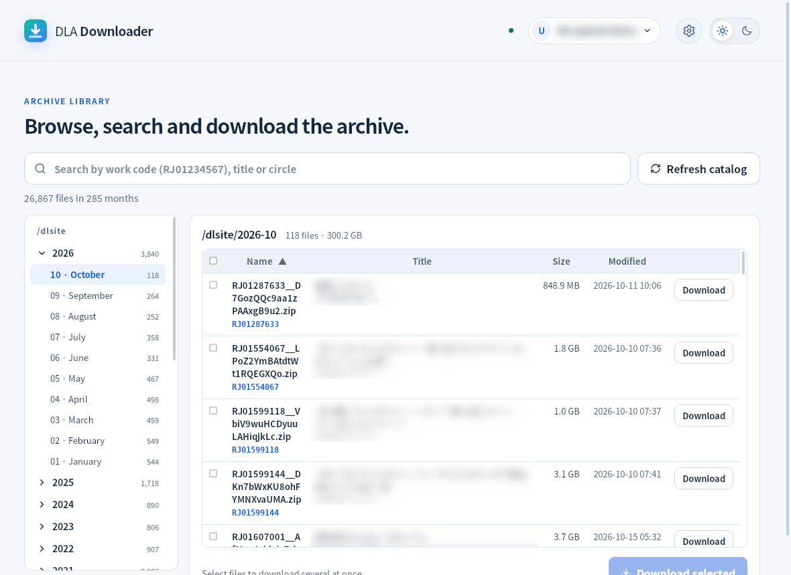
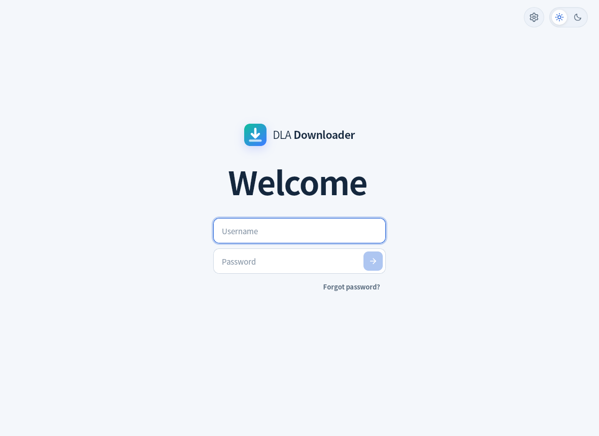
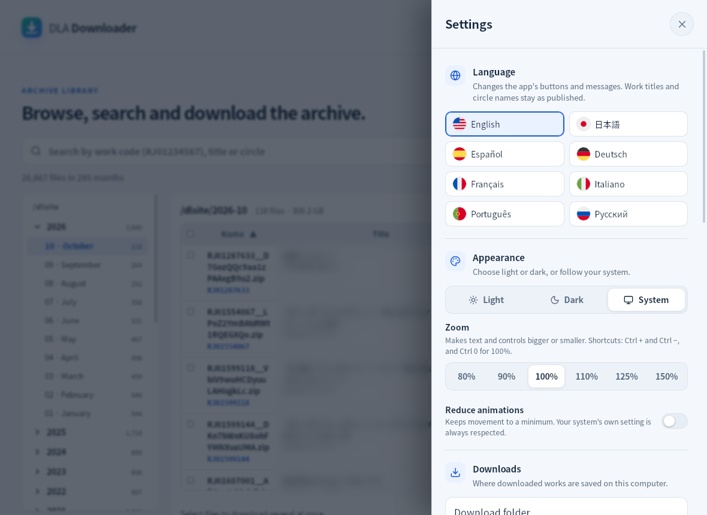

# DLA Downloader

DLA Downloader is a desktop app for DLA Elite patrons that makes downloading from the archive easier.

Sign in with your DLA account, choose a folder, and download the original archive files directly to your computer without using the FTP web page.

Available for **Windows** and **Linux**.

> DLA Downloader is still in early testing, so you may run into a few rough edges. If something doesn't work or you have a suggestion, let us know.

## What can it do?

- Browse the archive month by month.
- Search by work code, title, or circle.
- Download files to any folder you choose.
- Pause downloads and continue them later.
- Resume interrupted downloads without starting again.
- Check files you already have and skip matching ones automatically.
- Verify every downloaded file against its checksum.
- Change your email or password, or reset a forgotten password, from the app.
- Check for and install app updates.

## Screenshots

Browse the archive by month and download what you need:

<picture>
  <source media="(prefers-color-scheme: dark)" srcset="docs/screenshots/library-dark.png">
  
</picture>

Sign in with your DLA account:

<picture>
  <source media="(prefers-color-scheme: dark)" srcset="docs/screenshots/sign-in-dark.png">
  
</picture>

Choose the language, the look and your download folder in Settings:

<picture>
  <source media="(prefers-color-scheme: dark)" srcset="docs/screenshots/settings-dark.png">
  
</picture>

## Downloads and existing files

Choose a folder and start downloading.

If your connection drops or you pause a download, you can continue from where it stopped.

If you already have some files in the selected folder, DLA Downloader checks them first. Files that already match the archive are skipped, so you only download what you're missing.

Every completed download is also verified to make sure the file arrived correctly.

## Original archive files

DLA Downloader keeps the original archive files as they are stored on our servers.

It does not extract or install them automatically, so it's useful if you prefer to keep and organize the original files yourself.

## Your account and files

Sign in with the same DLA account you use on the site.

Your password is **never stored on your computer**.

The app only writes to its own settings folder and to the download folders you choose.

## Open source

DLA Downloader is open source under the **AGPL-3.0-only** license.

All source code is available in this repository, and releases are built from this code using GitHub Actions.

Each release also includes SHA-256 checksums so you can verify the downloaded installers yourself.

If you want to build the app locally, see [Building](docs/BUILDING.md).

## Need help?

If something doesn't work, you find a bug, or you have an idea for the app, feel free to let us know.

You can open a ticket from **Profile → Tickets** on the DLA website.

## License

Licensed under **AGPL-3.0-only**.

See [LICENSE](LICENSE) and [NOTICE](NOTICE).
